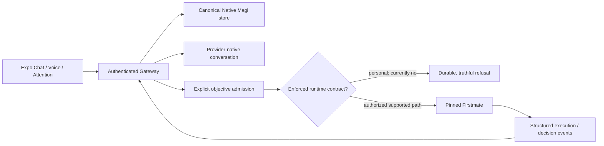

# Magistrate

An owner-facing engineering assistant with one persistent conversation across
Chat and Voice, explicit repository objectives, request-bound decisions, and
structured progress—not a terminal disguised as chat.

**Current portfolio candidate:** reviewable code, not an activated personal
execution release. Personal dispatch is deliberately closed because the reviewed
Firstmate pin cannot enforce the required worker/spend envelope. Dependency
advisories remain a mandatory red gate. No current-candidate deployed-runtime or
physical-iPhone acceptance is claimed. See the [acceptance report](docs/portfolio-acceptance-report.md).

## What is implemented

- FastAPI Gateway authentication, revocation, owner/project/repository authority,
  private uploads, and canonical Native Magi messages.
- Explicit server-selected personal mode: one exact authenticated principal;
  commercial checkout/credits detached, without weakening authorization.
- Atomic personal resource holds, frozen objective/context provenance, durable
  uncertainty/recovery, and measured terminal settlement. A reservation is **not**
  proof of runtime enforcement; unsupported publication fails before dispatch.
- Expo Chat/Voice sharing the same conversation; persisted structured Activity,
  Fleet, and Attention. Ordinary reads do not supervise workers.
- Request/revision/scope/expiry-bound decision support, canonical user-message
  answers, and explicit confirmation. Old unbound personal decisions are read-only.
- Native push test/delivery evidence and foreground voice/shortcut entry. Current
  voice is record/transcribe/TTS, not streaming speech-to-speech. Provider push
  acceptance/handoff is not evidence that a phone displayed a notification.



## Portfolio and operations

- [Case study](docs/portfolio-case-study.md): problem, architecture, tradeoffs, evidence.
- [Runbook](docs/portfolio-runbook.md): one startup/process owner, diagnostics, recovery, release gates.
- [Demo guide](docs/portfolio-demo-guide.md): safe presentation and blocked live scenarios.
- [Acceptance report](docs/portfolio-acceptance-report.md): automated versus live/device verdicts.
- [Career copy](docs/portfolio-career-copy.md): evidence-bounded project descriptions.

The commercial/hosted implementation remains separate and unchanged by personal
entitlement selection. Direct Codex/OpenCode runtime selection, autonomous fleet
supervision, and always-on/background voice are deferred—not fallback modes.

## Local development

Requires Python 3.12, uv, Node.js 22.13+ and npm. Configure a private development
environment using [`.env.example`](.env.example); never put credentials in
`EXPO_PUBLIC_*`. These are development commands, not deployment instructions:

```sh
git clone https://github.com/calvin-rutherford/Magistrate.git
cd Magistrate/gateway
uv sync --frozen
MAGISTRATE_ENV=development uv run uvicorn app.main:app --host 127.0.0.1 --port 8000 --reload
# A separate terminal, from the repository root:
cd frontend
npm ci
npx expo start --web
```

Validation:

```sh
(cd gateway && uv run pytest)
(cd frontend && npm run typegen && npm run typecheck && npm run lint && npm test && npx expo export --platform web)
```

`npm test` includes browser suites. A green build does not establish deployment,
runtime enforcement, APNs delivery, or physical-device acceptance. Production
and rollback authority remains [security and operations](docs/production-security-operations.md),
with [release gates](docs/PRODUCTION_STATUS.md). Legacy Pi/Django/Herdr launchers
are not conversation transports or rollback targets.
